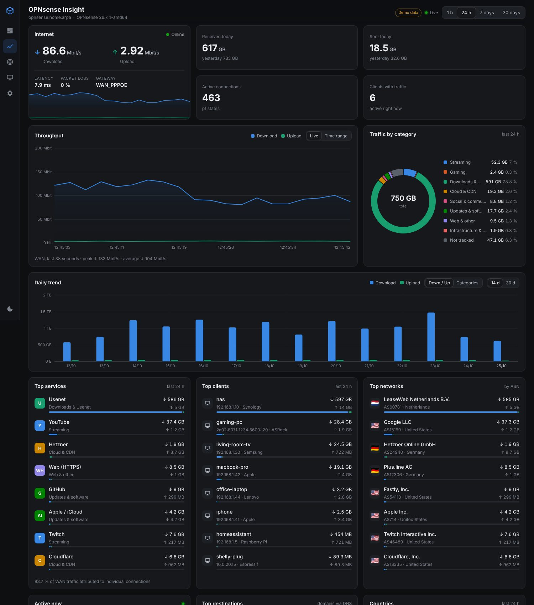

# OPNsense Insight

[](https://github.com/DieSteinhose/opnsense-dashboard/actions/workflows/docker.yml)

A statistics dashboard for OPNsense in the style of the UniFi Network dashboard: live throughput, daily trend, and above all **where** your traffic goes, broken down by service (Steam, Usenet, YouTube, Netflix, ...), category, client, network (ASN) and country. Dark mode is the default, light mode is one click away. The UI is available in English and German.



## What it shows

| Section | Source in OPNsense |
|---|---|
| Live throughput of the WAN and all interfaces (every 2 s) | `diagnostics/traffic/interface` (interface byte counters) |
| Today / yesterday, history from 1 h to 30 days, daily trend | the same counters, aggregated locally in SQLite (minutes for 7 days, hours for 400 days) |
| Top services, categories, clients, networks, countries, destinations | `diagnostics/firewall/query_states` (pf states with per-connection byte counters) |
| IP → domain (e.g. `cache2-fra1.steamcontent.com`) | `unbound/diagnostics/dumpcache` (Unbound DNS cache, CNAME chains included) |
| IP → network / country | free iptoasn.com database, local, refreshed weekly |
| Host names, vendors, IPv4 and IPv6 of one device merged | `diagnostics/interface/get_arp` + `get_ndp` (by MAC address) |
| "Active now" clients | `diagnostics/traffic/top` (iftop) |
| Latency, packet loss, gateways | `routes/gateway/status` |
| Uptime, load, memory, version | `diagnostics/system/*` |

**No plugins required.** Everything above comes from OPNsense core. The only requirement is that Unbound is the DNS resolver (the default); otherwise domain names are missing and traffic is attributed by port and ASN only.

### How traffic is attributed to services

Every connection (pf state) is polled every 15 s, and the bytes added since the previous poll are attributed to a service. The rules live in [`config/services.json`](config/services.json) and are applied in this order:

1. **Domain** from the DNS cache (longest match wins, so `steamcdn-a.akamaihd.net` is Steam, not Akamai)
2. **Port** (Usenet `tcp/563`, Steam `udp/27000-27100`, WireGuard, ...)
3. **ASN / network** (Valve AS32590, Netflix AS2906, Hetzner, Cloudflare, ...)
4. Fallback **Web (HTTPS/QUIC/HTTP)**, otherwise **Other**

Add your own rules to `services.json`, for example your Usenet provider or your VPN server. `label`/`name` are German, the optional `label_en`/`name_en` are used with `LANGUAGE=en`.

### Known limits

- Connections that open **and** close between two state polls are not seen by the collector. The difference to the interface counters is shown as **"Not tracked"** instead of being hidden. For large downloads (Steam, Usenet) this share is small, for many short web requests it is larger. The interval can be tuned with `POLL_STATES_MS`.
- History starts with the first run. OPNsense does not provide past per-connection data.
- True application detection via DPI (e.g. "Steam" through a generic CDN without a DNS match) needs a DPI plugin, see below.

## Getting started

### Docker (recommended)

GitHub Actions builds ready-made images for `linux/amd64` and `linux/arm64` (e.g. Raspberry Pi) on **Alpine 3.24** (Node.js 24 LTS) for every push to `main`:

```bash
cp .env.example .env      # set OPNSENSE_URL, OPNSENSE_KEY, OPNSENSE_SECRET, LANGUAGE
mkdir -p data && sudo chown 1000:1000 data
docker compose up -d      # pulls ghcr.io/diesteinhose/opnsense-dashboard:latest
# http://<host>:8080
```

To build locally instead of pulling, use `build: .` instead of `image:` in `docker-compose.yml`.

Image tags: `latest` (state of `main`), `sha-<commit>`, and for Git tags like `v1.2.3` also `1.2.3` and `1.2`.

### Without Docker (Node.js ≥ 22.13, no npm dependencies)

```bash
cp .env.example .env
npm start
```

### Demo without OPNsense

```bash
npm run demo     # seeds 14 days of sample history and simulates live traffic
```

### Checking the connection

```bash
npm run probe    # checks every API endpoint in use and writes data/probe.json
```

## Creating the API user in OPNsense

1. *System → Access → Users*: create a new user, e.g. `insight`, without a login shell.
2. Under **Effective Privileges**, grant read-only access only:
   - `Diagnostics: ARP Table`, `Diagnostics: NDP Table`, `Diagnostics: Show States`, `Diagnostics: Traffic Graph`, `Diagnostics: Interface`, `Diagnostics: System Activity`
   - `Status: Gateways`, `Reporting: Health`, `Services: Unbound DNS: Diagnostics`, `Dashboard (all)`
3. Create a key under the user's **API keys** and put key and secret into `.env`.

(Privilege names vary slightly between OPNsense versions. `npm run probe` shows what is missing: an `HTTP 403` means a missing privilege.)

## Optional: more data sources

| Plugin | Adds | Status |
|---|---|---|
| **os-ntopng** | real application detection via nDPI (Steam, Netflix, BitTorrent ... even without DNS) | good addition, integration planned as the next step |
| **Zenarmor (os-sunnyvalley)** | very detailed application and category detection | the free edition is enough for statistics |
| **NetFlow / Insight** (core, *Reporting → NetFlow*) | flow data for short-lived connections too | would shrink "Not tracked" |

## Configuration (`.env`)

| Variable | Default | Meaning |
|---|---|---|
| `LANGUAGE` | `de` | UI language: `de` or `en` |
| `OPNSENSE_URL` | | e.g. `https://192.168.1.1` |
| `OPNSENSE_KEY` / `OPNSENSE_SECRET` | | API key |
| `OPNSENSE_INSECURE` | `true` | accept a self-signed certificate; setting `OPNSENSE_CA` is better |
| `WAN_INTERFACES` | `wan` | OPNsense interface keys of the WANs, comma separated |
| `LOCAL_NETS` | auto | additional local networks (CIDR) |
| `ASN_LOOKUP` | `true` | load the iptoasn.com database |
| `POLL_STATES_MS` | `15000` | state poll interval |
| `MAX_STATES` | `20000` | maximum states per poll |
| `RETENTION_*_DAYS` | 7 / 400 / 90 / 14 | retention for minutes / hours / services / destinations |

## Layout

```
server/
  index.js        HTTP server, static files, SSE live stream
  opnsense.js     API client (basic auth, TLS)
  collector.js    polling, deltas, classification, aggregation
  classifier.js   service rules (DNS > port > ASN > fallback)
  dnsmap.js       IP → domain from the Unbound cache
  asn.js          IP → ASN/country (offline)
  db.js           SQLite (node:sqlite)
  api.js          JSON API for the frontend
  mock.js         demo backend returning OPNsense-shaped responses
public/           frontend without a build step (vanilla JS, canvas charts)
  i18n.js         English and German UI strings
config/services.json
scripts/probe.js  endpoint check against a real OPNsense
.github/workflows/docker.yml   tests + multi-arch image to GHCR
```
